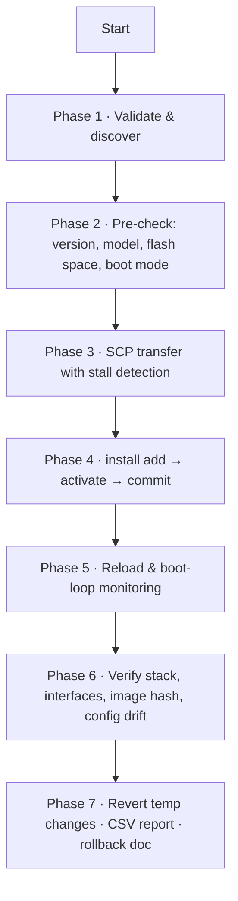

# Enterprise Cisco IOS-XE Upgrade Orchestrator

[](https://github.com/rainykarthick-crypto/cisco-xe-upgrade-orchestrator/actions/workflows/ci.yml)


[](https://github.com/rainykarthick-crypto/cisco-xe-upgrade-orchestrator/tags)

> **Build status.** `main` carries the **v35.9.43 development merge**, whose header/helper block
> is still missing. The runnable, tested build is the **`v35.9.34`** tag —
> `git checkout v35.9.34`. CI gates on that build (syntax, pyflakes, and the built-in
> **20/20 self-test**). Full evidence and the exact missing section:
> [`docs/PROJECT_STATUS.md`](docs/PROJECT_STATUS.md).

An enterprise-grade, multi-threaded Python automation tool that orchestrates, executes and
monitors bulk firmware upgrades across large fleets of Cisco Catalyst switches.

## 📖 Executive Summary

Upgrading hundreds of network switches by hand is slow, error-prone and disruptive. The
**Upgrade Orchestrator** runs the whole lifecycle — fleet discovery, pre-flight validation,
SCP transfer, `install add/activate/commit`, reboot monitoring and post-upgrade
verification — from one resumable, checkpointed run, and it reverts every temporary
configuration change it made before it exits.

## 🚦 Project status & quality gates

| Build | State | Use it? |
|---|---|---|
| `main` | v35.9.43 development merge — header, constants and helper block missing | ❌ not runnable |
| `v35.9.34` (tag) | complete build, **20/20 self-tests pass** | ✅ **use this** |

| Check | Complete build `v35.9.34` | Working tree `main` |
|---|---|---|
| `python -m py_compile orchestrator.py` | passes | passes |
| `python -m pyflakes orchestrator.py` | clean | 226 undefined names (expected — see status doc) |
| `python orchestrator.py --validate` | **20/20** | cannot run |
| `python orchestrator.py --help` | works | `NameError` |

The missing-symbol breakdown (14 stdlib imports · 57 available in v35.9.34 · 155 absent
everywhere) and the short path to finishing v35.9.43 are in
[`docs/PROJECT_STATUS.md`](docs/PROJECT_STATUS.md).

## ✨ Key Features

* **Concurrent fleet execution** — per-location worker pools, plus a bounded semaphore for
  large chassis (C9300/C9500) so a multi-hundred-MB transfer never starves the small models.
* **State-driven install engine** — each loop iteration reads the device, classifies its
  state and issues exactly one command. The only hard stop is a per-device deadline
  (`STATE_MACHINE_DEADLINE`), never an arbitrary sleep.
* **Session continuity** — the session that ran `install add` is the one that runs
  activate / commit / reload, so the Cisco install-engine lock is never raced.
* **Version-aware dispatch** — the activate command form is derived from the running
  IOS-XE version (the bare form is rejected on 17.10 and later).
* **Crash-resistant transfers** — SCP progress stall detection (kills a hung transfer),
  retry, retry-with-host-key, then automatic fallback to a tuned paramiko SFTP transfer.
* **Pre-flight space arithmetic** — reads free flash in bytes, adds extraction overhead and
  refuses to start (`insufficient_space`) instead of failing halfway through an install.
* **Self-healing boot state** — detects bundle vs install mode, repairs a missing
  `packages.conf` boot variable and clears stuck installer locks.
* **Temporary-change ledger** — every temporary config change (SSH tuning etc.) is recorded
  in `state/temp_changes_<RUN_ID>.json` and reverted, then verified, at the end of the run;
  `--recover` replays the ledger from an interrupted run.
* **Checkpoint & resume** — per-location and per-device checkpoints, so an interrupted run
  resumes instead of starting over.
* **Verification** — MD5 of the transferred image, post-reboot stack/interface health,
  running-config drift check and an optional reconcile pass.
* **Safe defaults** — `--validate`, `--check`, `--dry-run`, `--dry-run-revert`, and a
  confirmation prompt unless `--yes` is given.

## 🏗️ Architecture & Workflow



| Phase | What happens | Fails safe by |
|---|---|---|
| 1 · Discover | Load `locations/<name>.txt` (or `--hosts`), build device objects | Missing inventory is a warning, not a crash |
| 2 · Pre-check | Running version, model/firmware consistency, free flash vs. required bytes, boot mode | Emits `insufficient_space` / `firmware mismatch` and skips the device |
| 3 · Transfer | pscp (or paramiko fallback) pushes the image; MD5 verified | Stall detector kills a hung transfer, then retries / falls back |
| 4 · Install | `install add file flash:<image>` → `activate` → `commit`, one command per loop | Installer locks detected and cleared; state re-read every iteration |
| 5 · Reboot | ICMP down → up → stable, SSH ready, boot-loop detection | Bounded waits + `POST_REBOOT_MAX_ATTEMPTS` reconnects |
| 6 · Verify | Stack members, interfaces, post version, running-config drift | Failures land in the CSV/rollback doc for triage |
| 7 · Clean up | Revert recorded temp changes and verify them | `--recover` can replay a previous ledger |

More detail in [`docs/architecture_workflow.md`](docs/architecture_workflow.md).

## 📂 Repository layout

```text
cisco-xe-upgrade-orchestrator/
├── orchestrator.py            # v35.9.43 merge on main · complete build at tag v35.9.34
├── requirements.txt
├── config.example.json        # optional tuning overrides -> copy to config.json
├── examples/
│   ├── Location_HQ.txt        # sample inventory (safe placeholder IPs)
│   └── Location_Wada.txt
├── docs/
│   ├── architecture_workflow.md   # phases, state machine, failure taxonomy
│   └── PROJECT_STATUS.md          # what is complete, what is missing, how to finish
├── .github/
│   ├── workflows/ci.yml       # syntax, pyflakes, 20/20 self-test, repo hygiene
│   ├── dependabot.yml
│   ├── ISSUE_TEMPLATE/
│   └── pull_request_template.md
├── CHANGELOG.md
├── CONTRIBUTING.md
├── SECURITY.md
├── .gitattributes
├── LICENSE
└── README.md
```

At runtime the orchestrator uses a **base directory** (default `C:\Cisco_Upgrade`, overridable
with `--base-dir` or the `CISCO_UPGRADE_BASE` environment variable) containing:

```text
<base_dir>/
├── orchestrator.py
├── config.json        # optional: uppercase constants from the script
├── firmware/          # *.bin images and pscp.exe
├── locations/         # HQ.txt, Wada.txt, ...   (git-ignored)
├── logs/              # master + per-device logs, ROLLBACK_*.txt
├── reports/           # <location>_<RUN_ID>.csv
├── state/             # checkpoints, temp_changes_<RUN_ID>.json
└── backups/           # pre-change config backups
```

Run it from the repository root with `--base-dir .` (or set `CISCO_UPGRADE_BASE=.`) so the
`firmware/`, `locations/`, `logs/`… folders live next to the script.

## 🚀 Getting Started

### Prerequisites

* **Python 3.10 or newer** (the script's documented minimum)
* `netmiko` and `paramiko` (see `requirements.txt`)
* **`pscp.exe`** from [PuTTY](https://www.putty.org/) — place it in the base directory or on
  `PATH` for the fastest transfer path. It is optional: the orchestrator falls back to a
  tuned paramiko SFTP transfer when pscp is missing or fails.
* Cisco Catalyst **9200 / 9200L / 9200CX / 9300 / 9500** series running a supported IOS-XE
  release (target in this version: **17.18.04**)
* SSH and SCP reachable from the workstation; an account with privilege 15 and an
  enable secret

### Installation

```bash
git clone https://github.com/rainykarthick-crypto/cisco-xe-upgrade-orchestrator.git
cd cisco-xe-upgrade-orchestrator

python -m venv .venv
source .venv/bin/activate          # Windows: .venv\Scripts\activate
pip install -r requirements.txt
```

### Prepare the working directories

```bash
mkdir -p firmware locations logs reports state backups   # Windows: use `md`
cp examples/Location_HQ.txt     locations/HQ.txt         # then edit with your real devices
cp examples/Location_Wada.txt   locations/Wada.txt
copy your IOS-XE 17.18.04 image into firmware/
```

### Inventory format

One device per line; `#` starts a comment. Accepted separators: `,` `;` `|` or a tab, and
`hostname ip`, `ip hostname` or a bare IP are all understood:

```text
# hostname, ip
HQ-CORE-SW1, 10.10.10.1
HQ-ACC-SW1,  10.10.10.11
```

### Credentials

Pass them on the command line, or use environment variables:

```bash
export CISCO_USER=automation          # --user
export CISCO_ENABLE='<secret>'        # --enable-pass
export CISCO_ENABLE_USER=admin        # --enable-user (optional)
export CISCO_UPGRADE_BASE=/path/to/repo
```

### Usage

> These commands apply to a **complete build**. In this tree use tag `v35.9.34`
> (`git checkout v35.9.34`) — the v35.9.43 merge is missing its header, so the CLI cannot
> start yet (see [Project status](#-project-status)).

```bash
# 1. Self-test the script itself (no devices touched)
python orchestrator.py --validate

# 2. Read-only fleet sweep: running versions / models / boot mode
python orchestrator.py --check --base-dir . --locations HQ Wada

# 3. Dry run: full pre-flight, no device changes
python orchestrator.py --base-dir . --dry-run --locations HQ Wada

# 4. The real upgrade
python orchestrator.py --base-dir . --locations HQ Wada --yes

# 5. Ad-hoc devices, or a subset
python orchestrator.py --base-dir . --hosts SW1=10.10.10.1 SW2=10.10.10.2 --dry-run
python orchestrator.py --base-dir . --locations HQ --limit 5 --exclude HQ-ACC-SW2

# 6. Recover: revert temporary config left behind by an interrupted run
python orchestrator.py --base-dir . --dry-run-revert
python orchestrator.py --base-dir . --recover
```

### Tuning

Copy `config.example.json` to `<base_dir>/config.json`. Any **uppercase constant** that
exists in the script can be overridden that way (parallelism, timeouts, pscp usage):

```json
{
  "LARGE_MODEL_PARALLEL": 3,
  "STATE_MACHINE_DEADLINE": 2400,
  "PING_UP_TIMEOUT_SEC": 900
}
```

## 📊 Reporting

After each location the orchestrator writes:

| Artefact | Contents |
|---|---|
| `reports/<location>_<RUN_ID>.csv` | One row per device: model, start/target version, timings, result, failure reason |
| `reports/run_<RUN_ID>.html` | Visual success/failure dashboard (v35.9.43) |
| `logs/ROLLBACK_<location>_<RUN_ID>.txt` | Per-device rollback hint (previous image / `install` rollback commands) |
| `logs/master_*.log` + per-device logs | Full audit trail, including every command issued |
| `state/temp_changes_<RUN_ID>.json` | Temporary config changes that must be (and were) reverted |

## 🛡️ Operational safety

* Nothing changes a device until `--yes` (or an interactive confirmation) — `--dry-run`,
  `--check` and `--validate` are strictly read-only.
* A device is only marked successful after image hash, post-boot version and health checks.
* Every temporary change is recorded before it is made and reverted afterwards;
  `--recover` replays the ledger if a run is interrupted.
* Batch windows are respected: large chassis transfers are serialised behind a semaphore by
  default (`--no-serial-large` to interleave).
* The tool refuses to upgrade on a firmware/model mismatch or when the image cannot fit in
  flash.

## 📚 Documentation

| Document | Contents |
|---|---|
| [`docs/architecture_workflow.md`](docs/architecture_workflow.md) | phase model, per-device state machine, concurrency, failure taxonomy, checkpoints |
| [`docs/PROJECT_STATUS.md`](docs/PROJECT_STATUS.md) | build status, missing-symbol breakdown, how to finish v35.9.43 |
| [`CONTRIBUTING.md`](CONTRIBUTING.md) | invariants, dev setup, checks to run, PR process |
| [`SECURITY.md`](SECURITY.md) | vulnerability reporting and the credential/host-key risks of this tool |
| [`CHANGELOG.md`](CHANGELOG.md) | release history |
| [`.github/workflows/ci.yml`](.github/workflows/ci.yml) | CI: syntax, pyflakes, self-test, repo hygiene |
| [`LICENSE`](LICENSE) | MIT |

## 🤝 Contributing

Issues and pull requests are welcome. Please never commit real inventory files, firmware
images or credentials — `locations/`, `firmware/`, `logs/`, `reports/`, `state/` and
`backups/` are already git-ignored, and `examples/` contains placeholder data only.

Before opening a pull request run `python -m py_compile orchestrator.py`,
`python -m pyflakes orchestrator.py` and `python orchestrator.py --validate` — see
[`CONTRIBUTING.md`](CONTRIBUTING.md).

## 📄 License

Distributed under the MIT License. See [`LICENSE`](LICENSE) for details.
