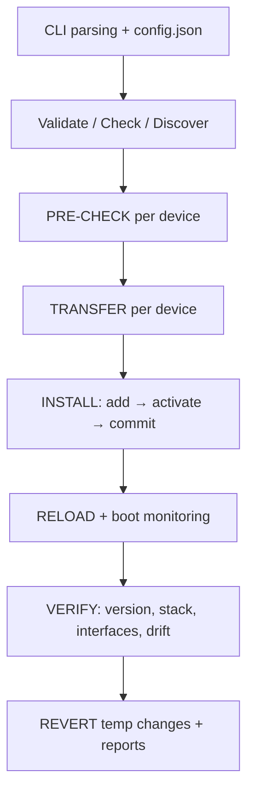

# Architecture & Workflow

This document explains how `orchestrator.py` drives a fleet upgrade: the phase model, the
per-device state machine, the concurrency model, the safety invariants it must never break,
and the artefacts a run leaves behind.

Version: **35.9.34** · Target release: **IOS-XE 17.18.04** · Platforms: Catalyst 9200 /
9200L / 9200CX / 9300 / 9500.

---

## 1. Design invariants

These rules are the reason the tool is safe to point at a production fleet. Any change to
the orchestrator must preserve them.

| # | Invariant | Why it matters |
|---|---|---|
| 1 | **State driven, never timer driven.** Every install-loop iteration reads device state, classifies it, and issues exactly one command. The only hard time stop is the per-device deadline. | Timers race against boot time; state reads cannot. |
| 2 | **Session continuity.** The session that ran `install add` also runs `activate`, `commit` and the pre-reload steps. | A second session racing the install engine lock produces the classic "installer is already running" wedge. |
| 3 | **Version-aware dispatch.** The activate command form is chosen from the running IOS-XE version (the bare form is rejected on 17.10+). | One command form cannot serve every release. |
| 4 | **Service locks everywhere.** Even devices already on the target release get the service lock treatment, so a concurrent manual change cannot collide. | Mixed fleets are the normal case. |
| 5 | **Temporary changes are recorded before they are made**, and reverted (and verified) at the end of the location run. | SSH/tuning changes must not outlive the maintenance window. |
| 6 | **No destructive action without a checkpoint.** Progress is checkpointed per location and per device. | A crashed run must be resumable, not restarted. |

---

## 2. Phase model



| Phase | Key operations | Output |
|---|---|---|
| **Bootstrap** | Parse CLI (`--locations`, `--hosts`, `--limit`, `--exclude`, `--base-dir`, `--config`), load `config.json` overrides, establish `RUN_ID`, create `logs/`, `reports/`, `state/`, `backups/` | run context |
| **Discovery** | `locations/<name>.txt` → `Device(hostname, ip, location, target)`; `--hosts SW1=ip` for ad-hoc devices | device list |
| **PRE-CHECK** | `show version`, model/firmware consistency, `show boot` (bundle vs install), free-flash vs required bytes (image + extraction overhead) | `insufficient_space` / `firmware mismatch` skips |
| **TRANSFER** | pscp with progress stall detection → retry → retry-with-host-key → paramiko SFTP fallback; MD5 verify | image on `flash:` |
| **INSTALL** | `install add file flash:<image> activate commit`-style sequence, one command per state read; installer-lock detection and clearing; `packages.conf` repair for install-mode boot | activated/committed image |
| **RELOAD** | ICMP down → up → stable, SSH ready, boot-loop detection, bounded reconnect attempts | device back in service |
| **VERIFY** | post version, stack members, interface state, running-config drift, optional reconcile | result row |
| **CLEANUP** | revert every entry in the temp-change ledger and verify the revert | CSV + rollback doc |

---

## 3. Per-device state machine

`set_state(host, stage, step)` is the observability spine: every device reports
`stage/step` while it moves through:

```
PRE-CHECK  (clock · model · readiness · version · wiping)
   │
TRANSFER   (pscp · paramiko · hash-verify)
   │
INSTALL    (add · activate · commit · repair)
   │
VERIFY     (post-boot · stack · interfaces · drift)
   │
DONE / FAILED (reason recorded in the CSV and rollback document)
```

The loop never sleeps blindly between steps: it re-reads the device and decides.

---

## 4. Concurrency model

* A **location worker** runs each location's device list through the phases.
* Large chassis (C9300/C9500) are serialised behind a bounded semaphore
  (`LARGE_MODEL_PARALLEL`, default 3) because one image transfer saturates management
  bandwidth and starves smaller devices. `--no-serial-large` interleaves them instead.
* `--parallel-large N` tunes the semaphore per run; `LARGE_MODEL_PARALLEL` in `config.json`
  tunes it permanently.
* Transfer threads are separate from the per-device state machine, so a slow SCP does not
  block state monitoring of other devices.

---

## 5. Failure taxonomy

| Failure | Detected as | Recovery |
|---|---|---|
| Image will not fit | `insufficient_space: <free> free, <need> needed` (pre-check) | device skipped, run continues |
| Wrong image for the model | `firmware mismatch: …` | device skipped |
| SCP hang / silent stall | `pscp stalled Ns with no output` → process killed | retry, retry-with-host-key, paramiko fallback |
| Install engine locked | installer-lock detection | lock cleared, state re-read, command retried |
| Boot variable lost | `packages.conf` missing from `show boot` | boot variable repaired before activate |
| Device does not return | `device did not return after activate` | bounded ICMP/SSH waits, then device marked failed |
| Boot loop | `boot loop detected` | device marked failed, rollback hint written |
| SSH not ready after reload | `SSH did not return after activate` | bounded reconnects, then failed |
| Commit not verified | `commit could not be verified` | device marked failed, retained in rollback doc |

Every failure ends up in `reports/<location>_<RUN_ID>.csv` **and** `logs/ROLLBACK_<location>_<RUN_ID>.txt`.

---

## 6. Checkpointing and resume

* `state/` holds per-location and per-device checkpoints plus
  `temp_changes_<RUN_ID>.json` (the ledger of temporary configuration).
* An interrupted run resumes from the device-level checkpoint rather than re-upgrading
  devices that already completed.
* `--recover` (alias `--revert-only`) replays the temp-change ledger of a previous run;
  `--dry-run-revert` prints what would be reverted without touching devices.

---

## 7. Artefacts

```text
<base_dir>/
├── logs/
│   ├── master_<RUN_ID>.log            # orchestration decisions
│   ├── <host>_<RUN_ID>.log            # every command + output for one device
│   └── ROLLBACK_<loc>_<RUN_ID>.txt    # per-device rollback procedure
├── reports/
│   └── <loc>_<RUN_ID>.csv             # one row per device (model, versions, timings, result)
├── state/
│   ├── checkpoint_<loc>.json          # resume points
│   └── temp_changes_<RUN_ID>.json     # ledger reverted at the end of the run
└── backups/
    └── <host>_<RUN_ID>_*.cfg          # pre-change configuration snapshots
```

---

## 8. Running a safe campaign

1. `--validate` — self-test the script in isolation.
2. `--check` — read-only sweep; confirm versions, models and boot modes.
3. `--dry-run` — full pre-flight including flash arithmetic and image/hash checks.
4. **Canary**: one location, small `--limit`, then verify its CSV and rollback doc.
5. **Wave rollout**: remaining locations with `--yes`, watching `logs/master_*.log`.
6. `--recover` if a run was interrupted; check `temp_changes_*.json` is empty afterwards.

---

## 9. Extension points

* `config.json` — override any uppercase constant (parallelism, timeouts, pscp usage,
  deadline). See `config.example.json`.
* `locations/*.txt` — plain-text inventory, one device per line, `#` comments allowed.
* `--hosts` — ad-hoc devices without an inventory file.
